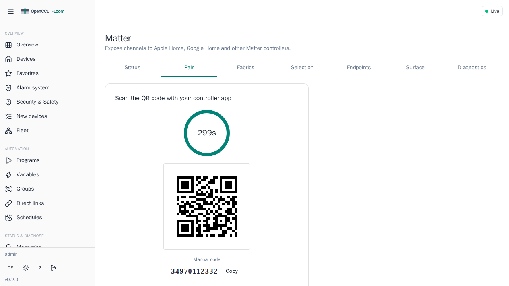

# Matter Bridge

OpenCCU-Loom can expose your Homematic devices to Matter ecosystems — Apple Home, Google Home, and Amazon Alexa — so you can control them from those apps. This page explains how to turn the bridge on and pair it.

!!! info "Who this page is for"
    End users who want their Homematic devices to appear in Apple Home, Google Home, or Alexa. No Go knowledge required; some familiarity with your smart-home app helps.

!!! warning "Maturity: alpha"
    The Matter bridge is the youngest and least proven part of OpenCCU-Loom — the daemon as a whole is beta, this bridge is **alpha**. It works, and it is tested against Apple Home, Google Home and `chip-tool`, but expect rough edges: pairing that needs a second attempt, devices that map to a Matter type differently than you would guess, and behaviour that varies per ecosystem. It is off by default; turning it on is an explicit test decision. Do not build automations on it that something depends on, and read [Controller ecosystem caveats](#controller-ecosystem-caveats) and [Limitations](#limitations) below before you start.

## What the Matter bridge does

When enabled, OpenCCU-Loom advertises itself on your network as a single Matter **bridge**. Each selected Homematic device shows up inside that bridge as a Matter accessory of the appropriate type (a light, a lock, a sensor, and so on). You then pair the bridge once with your ecosystem, and all its accessories appear together.

The bridge is **off by default**. You must explicitly enable it.

## Enabling the bridge

Set `north.matter.enabled` to `true` in your daemon configuration:

```yaml
north:
  matter:
    enabled: true
    # Optional. The bridge name your ecosystem will show. Defaults to "openccu-loom".
    node_label: "Home Bridge"
    # Optional. UDP listen address. Defaults to ":5540".
    listen: ":5540"
    commissioning:
      # The Matter setup passcode (00000001..99999998). Leave 0 (the default)
      # and pair through a one-time window opened in the web UI instead.
      passcode: 20202021
```

The bridge listens on UDP port **5540** by default. With a **passcode** under `north.matter.commissioning.passcode`, the pairing codes are fixed and always available. Left at `0`, the bridge runs on a random passcode nobody holds: there are no fixed pairing codes (`GET /api/v1/matter/setup-payload` answers 503), and you pair by opening a commissioning window in the web UI, which shows one-time codes for that window.

If you configured your own attestation files (`north.matter.attestation.*`) and they do not load, the bridge keeps serving every controller already paired but refuses every new pairing until the files are fixed and the daemon restarts. You see it in three places: the **Diagnostics** view lists the health component `matter.bridge` as unhealthy with the note *commissioning disabled: the configured attestation chain does not load*, opening a commissioning window answers `409 Conflict` with the same reason, and the daemon log names the cause (message `matter.bridge.attestation`). Without own attestation files this does not apply.

For the full set of keys (vendor/product IDs, discriminator, attestation, CASE), see [Configuration](../admin/configuration.md). Restart the daemon after changing the config — see [Getting started](../getting-started.md).

!!! warning "Test vendor identity — your ecosystem may flag it as uncertified"
    By default the bridge advertises the **test** vendor ID `0xFFF1` and product ID `0x8000`. These are development identifiers, not a certified production identity. Apple Home, Google Home, and Alexa may warn that the bridge is an **uncertified / test accessory** during pairing. This is expected for a self-hosted bridge; you can usually accept and continue. Setting real, vendor-assigned IDs and attestation material is an expert/production step covered in [Configuration](../admin/configuration.md).

## Finding your pairing codes

To pair, your phone app needs either the **setup QR code** or the **11-digit manual pairing code**. OpenCCU-Loom generates both from your configured passcode and discriminator.

- **In the web UI:** open the **Matter** view, which shows the QR code and the manual code ready to scan or type.
- **Via the API:** `GET /api/v1/matter/setup-payload` returns the QR payload and the manual code. (It returns "not configured" if no passcode is set.)



!!! tip
    Keep the passcode private — anyone with the code can add your bridge to their own home.

## The Matter view

The **Matter** view (shown only while the bridge is enabled) has four tabs:

- **Expose** — pick which devices the bridge advertises (see [Choosing which devices are exposed](#choosing-which-devices-are-exposed)).
- **Fabrics** — every controller ecosystem the bridge is paired with, by vendor, label, fabric number and node ID. **Remove** unpairs one controller; the others keep working. Under **Maintenance**, **Re-sync topology** rebuilds the exposed endpoints from the current devices while every controller keeps its pairing, and **Remove all pairings** returns the bridge to its unpaired state — every controller then has to add it again. **Share bridge with another controller** leads to the **Pair** tab.
- **Pair** — open a commissioning window with its QR code, manual code and countdown, and close it again early.
- **Diagnostics** — whether the bridge advertises correctly on the network, the connected controllers, the exposed endpoints, how each paired ecosystem treats the exposed device types, and recent bridge events.

Removing a fabric, removing all pairings, re-syncing and opening or closing a commissioning window need an administrator account. The same actions are available over the REST API under `/api/v1/matter/` — see the [REST reference](../reference/rest.md).

## Pairing step by step

The flow is the same idea everywhere: add an accessory, then scan the QR or enter the manual code.

=== "Apple Home"

    1. Open the **Home** app and tap **+** → **Add Accessory**.
    2. Scan the **QR code** from the OpenCCU-Loom Matter view (or tap "More options" to enter the manual code).
    3. If prompted that the accessory is uncertified, choose **Add Anyway**.
    4. Wait for the bridge and its devices to be set up, then assign rooms and names.

=== "Google Home"

    1. Open the **Google Home** app and tap **+** → **Set up device** → **New device**.
    2. Choose **Matter-enabled device** and scan the **QR code**, or enter the manual code.
    3. Acknowledge any uncertified-device prompt to continue.
    4. Finish setup and assign rooms.

=== "Amazon Alexa"

    1. Open the **Alexa** app → **Devices** → **+** → **Add Device**.
    2. Pick **Other** / **Matter** and choose to scan the **QR code** or enter the manual code.
    3. Acknowledge any uncertified-device prompt.
    4. Let Alexa discover the bridged accessories.

After pairing the bridge once, the individual Homematic devices appear in the app automatically. Adding the bridge to additional ecosystems uses a fresh commissioning window — open one from the Matter view (the **commissioning window** action) and pair again with the new code.

## Supported device types

OpenCCU-Loom maps Homematic devices to these Matter device types. Anything it cannot map is simply not exposed.

| Matter device type | Typical Homematic source |
|--------------------|--------------------------|
| On/Off Light | Switch-actuator used as a light |
| Dimmable Light | Dimmer |
| Color Temperature Light | Tunable-white light |
| Extended Color Light | Color (RGB) light |
| On/Off Plug-in Unit | Switch / plug actuator |
| On/Off Plug-in Unit | Alarm siren (HmIP-ASIR) — On/Off switches the alarm; tone and light selection are not carried over |
| Window Covering | Blind / shutter / cover |
| Thermostat | Heating thermostat |
| Door Lock | Door lock / keymatic |
| Contact Sensor | Door/window contact (leak-class sensors will also surface here once classified) |
| Occupancy Sensor | Motion / presence sensor |
| Temperature Sensor | Temperature measurement |
| Humidity Sensor | Humidity measurement |
| Light Sensor | Illuminance measurement |
| Pressure Sensor | Air-pressure measurement |
| Generic Switch | Button / momentary switch |
| Smoke / CO Alarm | Smoke detector with siren (HmIP-SWSD) — reports the smoke state |
| Air Quality Sensor | CO₂ / particulate sensor |

### Power and energy measurement

Measuring devices — a switch-measuring plug such as the HmIP-PSM, for
example — also surface their electrical readings to Matter. Instantaneous
power, voltage, current and frequency appear via the **Electrical Power
Measurement** cluster and cumulative consumption via the **Electrical Energy
Measurement** cluster. Both sit on a separate **Electrical Sensor** endpoint
alongside the plug's switch endpoint, which is where the Matter Device Library
specifies them; ecosystem apps that understand these clusters (for example the
energy screens in newer Apple Home and Google Home builds) show the live and
accumulated values there.

!!! note "Metering plugs re-learn once after updating"
    These clusters previously sat on the plug's switch endpoint, which the
    Device Library does not specify for that device type — Alexa in particular
    recognises a bridged endpoint only by the clusters its device type names.
    After updating, a paired metering plug gains a second accessory carrying
    the readings. This is a one-time step.

### Buttons / momentary switches

Momentary controls — wall buttons, remotes — map to the **Generic Switch**
device type, with **one endpoint per physical button**. Each button emits
Matter switch events for a single press, a long press, and multi-press, so
your ecosystem can distinguish short-tap, hold, and double-tap automations.

!!! note "Button accessories re-learn once after updating"
    The move to one endpoint per physical button renumbered how buttons are
    exposed. After updating, a paired button device may appear with new
    endpoints; re-create any automations that targeted the old ones. This is
    a one-time step.

### Battery level

Battery-powered devices report their level through the **Power Source**
cluster, which rides on the device's own accessory rather than appearing as a
separate one. A device has one battery, so exactly one of its endpoints
carries the cluster.

## Choosing which devices are exposed

You do not have to expose everything. The **Matter** view lets you pick which devices the bridge advertises, so your Home app stays uncluttered. Changes take effect on the bridge without re-pairing it.

By default OpenCCU-Loom exposes one Matter endpoint per device. The expert flag `north.matter.expose_secondary_channels` opts a device's *secondary* actor channels out into their own extra endpoints — useful for multi-channel actuators (for example a dual switch) where you want each channel as a separate Matter accessory. Leave it off unless you specifically need the fan-out; see [ADR 0049](../adr/0049-matter-one-endpoint-per-device.md).

## Groups, scenes, restarts and TCP

- **Matter groups and scenes work on every light, switch and siren.** A controller can put bridged endpoints into Matter groups (AddGroup / RemoveGroup, group commands over multicast) and store scenes on them; group membership and scene tables are kept in the daemon's database and survive a restart.
- **Subscriptions survive a daemon restart.** The bridge persists each controller's subscriptions and re-establishes them after a start, so a controller does not have to wait out its own liveness timeout before the bridge reacts again.
- **Matter over TCP is available, off by default.** `north.matter.tcp: incoming` accepts TCP connections on the Matter port next to UDP and advertises it to controllers; a controller that supports TCP then moves large reads off the retransmission protocol. Leave it off unless a controller in your fleet uses it — see the key in the [configuration reference](../admin/configuration.md).

## Controller ecosystem caveats

Matter controllers do not implement the specification uniformly — each ecosystem supports its own subset of device types, ports, and fleet sizes. The field observations below were collected by the [home-assistant-matter-hub](https://github.com/RiDDiX/home-assistant-matter-hub) project; some of them shape how OpenCCU-Loom maps devices.

- **Amazon Alexa commissions bridges only on UDP port 5540.** A bridge bound to any other port pairs fine with Apple Home and Google Home but silently fails Alexa commissioning. This matters when another Matter service on the same host already occupies port 5540 (for example, Home Assistant's Matter server add-on): commission Alexa while the bridge is listening on 5540 (`north.matter.listen`), because pairing on an alternative port will not work with Alexa.
- **Alexa caps the number of devices per bridge.** Alexa cannot pair with a bridge that exposes too many accessories — the practical limit is roughly 80–100 devices. Larger fleets should not be exposed wholesale to an Alexa fabric; trim the selection first (see [Choosing which devices are exposed](#choosing-which-devices-are-exposed)).
- **Alexa lags behind current Matter device-type revisions.** Newer detector device types — such as the Water Leak Detector introduced in Matter 1.3 — can render an entire bridge unresponsive on Alexa: every accessory on the bridge stops reacting. OpenCCU-Loom therefore maps the leak measurement class to the universally supported Contact Sensor device type (leak/moisture parameters are not classified yet; the mapping is in place so future leak sensors never surface the hazardous detector type).
- **The WaterValve device type is unsupported by both Google Home and Amazon Alexa.** OpenCCU-Loom exposes the irrigation valve as a plain on/off endpoint instead, which all three ecosystems handle — see [ADR 0049](../adr/0049-matter-one-endpoint-per-device.md).

## Limitations

- Only the device types in the table above are exposed; unmapped devices stay Homematic-only.
- Some Homematic features have no direct Matter equivalent and are not carried over.
- A device must be mappable to a supported Matter type before it can be exposed.
- The default test vendor identity means ecosystems may treat the bridge as uncertified (see the warning above).

For the technical contract behind the Matter mapping, see [`docs/matter-parity-contract.md`](../matter-parity-contract.md); the per-ecosystem findings behind the caveats above are collected in [Matter Ecosystem Observations](https://github.com/SukramJ/go-fabric/blob/main/docs/matter-ecosystem-observations.md).

## Where to go next

- [Getting started](../getting-started.md) — install and first run.
- [Core concepts](concepts.md) — devices, channels, and data points.
- [Configuration](../admin/configuration.md) — full Matter and daemon settings.
